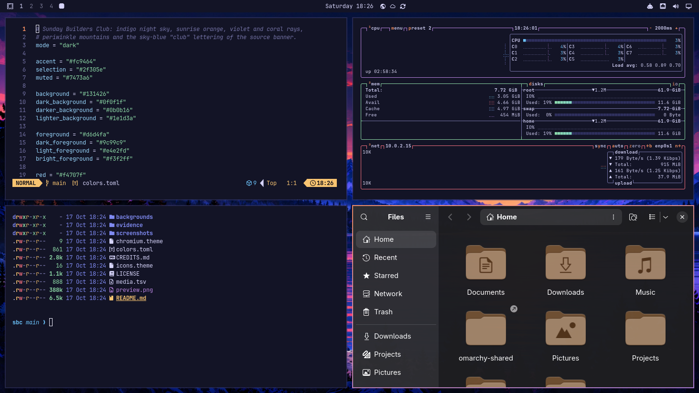
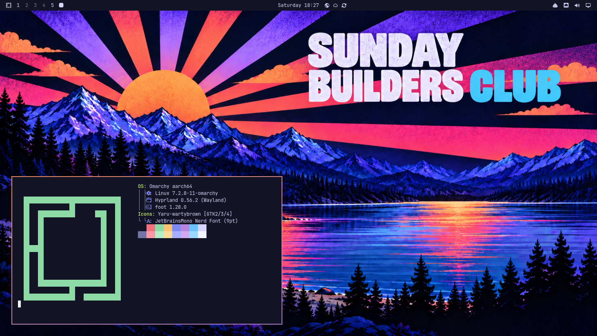
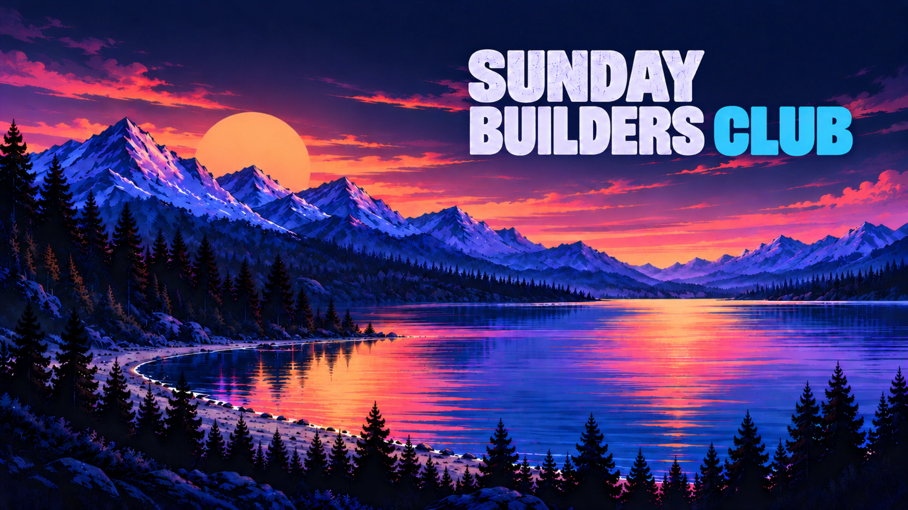
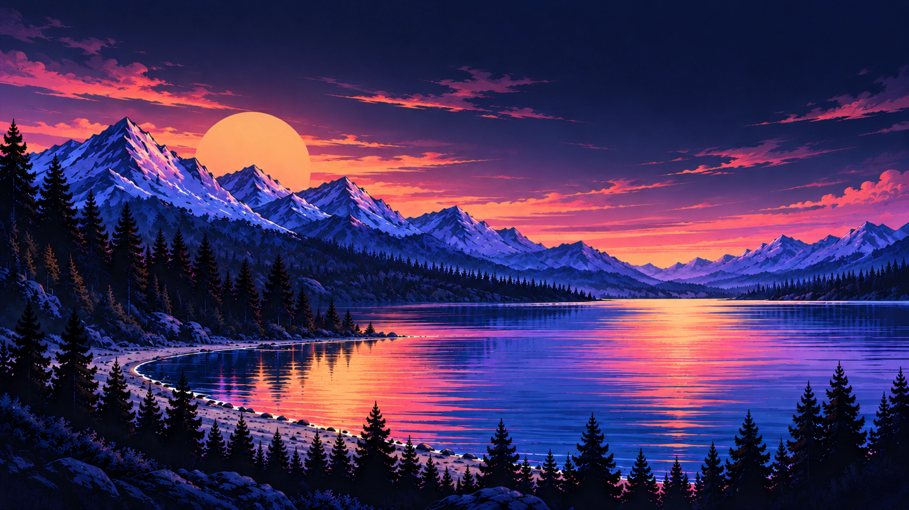
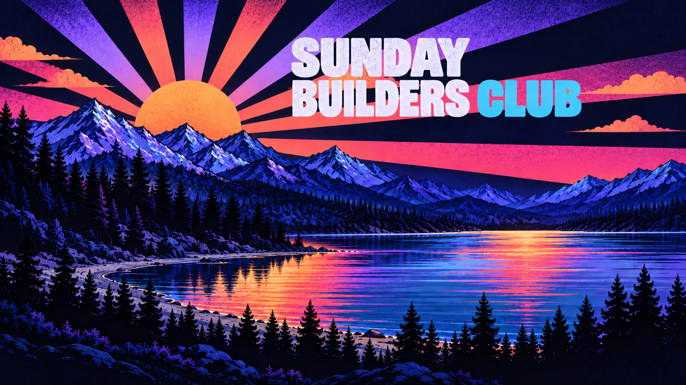
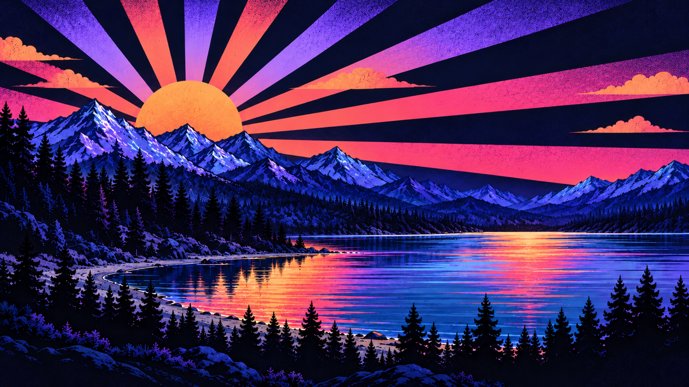

# omarchy-sbc-theme

<p>
  <a href="https://github.com/tcballard/omarchy-badges"></a>
  
  
</p>

Status: development preview
Intended Omarchy target: Quattro (source revision f4357a3; confirm for this theme)
Tested installed Omarchy version: none

The category badge is a community label, not certification. The target is not a tested-version claim.

**SBC** is a dark theme drawn from the Sunday Builders Club banner by
[@ncfrontiersman](https://x.com/ncfrontiersman): an indigo night sky, a
peach-orange sunrise with violet and coral rays, periwinkle mountains and the
sky-blue "club" lettering.



*SBC on Omarchy with Neovim, btop, a terminal and Files, 1664×937*

## Install

Note your current theme first, so you can go back to it:

```bash
omarchy theme current
```

Then install SBC:

```bash
omarchy theme install https://github.com/simoz/omarchy-sbc-theme
```

This clones the theme into `~/.config/omarchy/themes/sbc` and applies it
straight away. If that folder already exists, the installer deletes it first.
You can also paste the URL in the Omarchy menu under **Install › Style › Theme**.

Cycle through the four wallpapers with `omarchy theme bg next`.

## Update

```bash
omarchy theme update
```

This pulls the latest version of every theme installed from a git repository.

## Rollback

Set the theme you noted before installing, for example:

```bash
omarchy theme set "Tokyo Night"
```

Omarchy brings back the wallpaper you last used with that theme.

## Uninstall

Switch to another theme first (see Rollback), then remove SBC:

```bash
omarchy theme remove sbc
```

`omarchy theme remove` deletes `~/.config/omarchy/themes/sbc`. Run it without a
name to pick the theme from a list instead.

## Screenshots



*SBC desktop with the retro wallpaper and the About window, 1664×937*

## Palette

| Role | Colour | From the banner |
| --- | --- | --- |
| background | `#131426` | night sky |
| foreground | `#d6d4fa` | lavender lettering |
| accent / orange | `#fc9464` | the sun |
| magenta | `#b884e0` | violet rays |
| red | `#f4707f` | coral rays |
| blue | `#7f8af2` | lit mountain faces |
| cyan | `#6cc4fc` | "CLUB" lettering |
| selection | `#2f305e` | mountain shadows |

Active windows get a sunrise border that runs from orange to violet
(`hyprland_active_border`); inactive ones fall back to a dim indigo.
Green and yellow are added for terminal use, since the banner has none.

## Wallpapers

Four 3840×2160 WebP backgrounds in two styles, each with and without the club
lettering (see [credits](CREDITS.md) for how they were made). Omarchy shows
them in file-name order, so the first one is the default:

<table>
  <tr>
    <td></td>
    <td></td>
  </tr>
  <tr>
    <td><code>backgrounds/sunday-omarchy-con-scritta-4k.webp</code> (default): Omarchy-style sunset over the lake with the Sunday Builders Club lettering, 3840×2160</td>
    <td><code>backgrounds/sunday-omarchy-senza-scritta-4k.webp</code>: Omarchy-style sunset over the lake without lettering, 3840×2160</td>
  </tr>
  <tr>
    <td></td>
    <td></td>
  </tr>
  <tr>
    <td><code>backgrounds/sunday-retro-con-scritta-4k.webp</code>: Retro sunburst over the lake with the Sunday Builders Club lettering, 3840×2160</td>
    <td><code>backgrounds/sunday-retro-senza-scritta-4k.webp</code>: Retro sunburst over the lake without lettering, 3840×2160</td>
  </tr>
</table>

The Omarchy-style pair is an artistic interpretation of Omarchy Quattro's
landscape backgrounds, not an official Omarchy asset. The retro pair keeps the
banner's sunburst. Both show snow-capped periwinkle mountains, a reflecting
lake and pine forests under a sunset sky.

## Application colours

Folder icons use `Yaru-wartybrown`, the same variant Omarchy's built-in Retro 82
theme uses for its peach-orange accent. The Chromium-family browser seed is
`30,29,58`, an intentional indigo tint that matches the background; browser seeds
do not guarantee exact surface colours, and the browser tint has not been
checked on a desktop yet.

## Media and credits

The four wallpapers were generated with an AI image generator from the Sunday
Builders Club banner, original artwork by
[@ncfrontiersman](https://x.com/ncfrontiersman), resampled to 3840×2160 and
encoded as WebP (quality 95); they are not native 4K renders. Permission to
redistribute them is pending; see [credits](CREDITS.md).
`preview.png` and `screenshots/desktop.png` are screenshots of the theme
applied on Omarchy.

Licence: [MIT](LICENSE), for the theme's palette and configuration files. It
does not cover the wallpaper artwork, which is derived from @ncfrontiersman's
banner.

## Validation limits

See [validation evidence](evidence/checks.tsv). Contrast, image-decoding and
upstream template-rendering checks were run in a build container. The theme was
then applied once from a local copy on Omarchy 4.0 in a virtual machine to take
the screenshots; installing from Git and registry acceptance have not been
tested. The Build Omarchy Themes helper rejects the gradient border key by
design (it accepts `#RRGGBB` only); the same palette passes it without that key,
and Omarchy's own renderer handles the gradient. The handoff checker checks
file/evidence consistency, not whether recorded commands were actually executed
or the theme looks correct.
